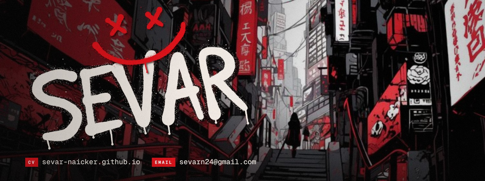
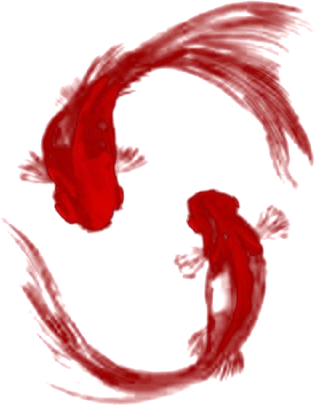
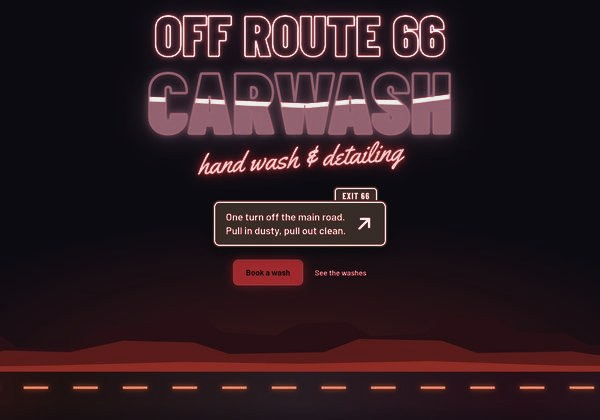
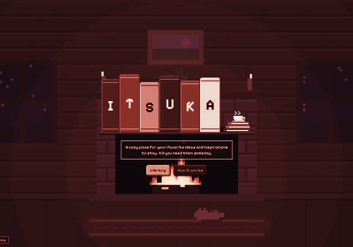
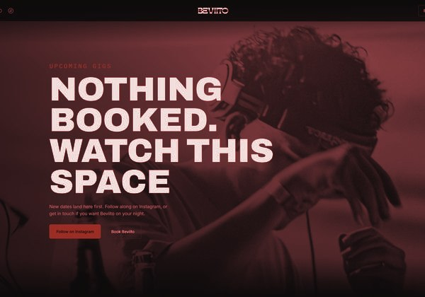
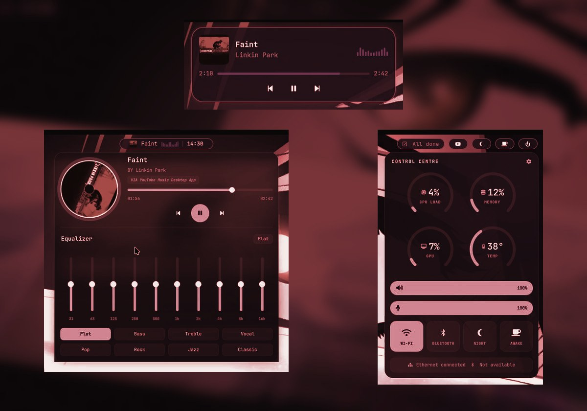
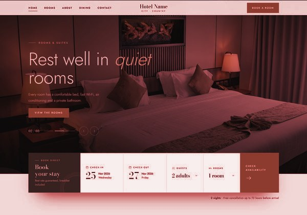
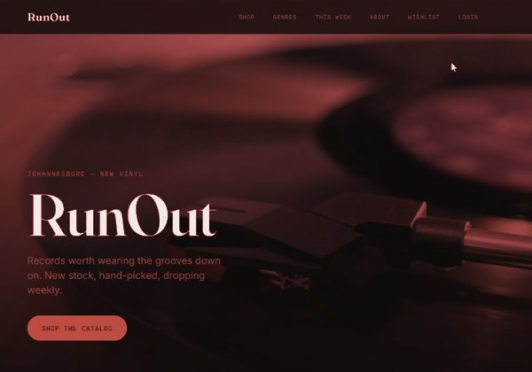

<h2 align="center">Know About Me</h2>

<table>
<tr>
<td width="30%" align="center">

</td>
<td width="70%">

### Welcome, I'm Sevar Naicker

I'm a **third-year student developer at the University of Johannesburg**, studying Informatics, Computer Science, IT Management, Business Management, Electrotechnics and Maths.

I build websites for clients and friends, and applications for myself. In my spare time I write software for my own projects: my car, my bike, and small gadgets that make everyday life a little easier. When I'm not doing that, I'm adding features to Ukishima, my KDE Plasma setup, one menu at a time.

</td>
</tr>
</table>

<h2 align="center">Top Projects</h2>

<table>
<tr>
<td width="50%" valign="top">

 <a href="https://sevar-naicker.github.io/Off-Route-66/"><b>Off Route 66 ↗</b></a> &nbsp;<code>Client</code>
 A neon Route 66 website for a carwash, with soap-water-filled lettering and a road-sign tagline
 <b>HTML · CSS · JS</b>
</td>
<td width="50%" valign="top">

 <a href="https://itsuka.co.za"><b>Itsuka ↗</b></a> &nbsp;<code>Web app</code>
 A pixel-art library of artists, creators and small businesses to support later
 <b>HTML · CSS · JS · Supabase</b>
</td>
</tr>
<tr>
<td width="50%" valign="top">

 <a href="https://sevar-naicker.github.io/Beviito/"><b>Beviito ↗</b></a> &nbsp;<code>Website</code>
 A DJ's website with a Stream Deck-style track grid and an in-browser player
 <b>HTML · CSS · Web Audio</b>
</td>
<td width="50%" valign="top">

 <a href="https://github.com/Sevar-Naicker/Waybar"><b>Ukishima ↗</b></a> &nbsp;<code>Linux desktop</code>
 My Waybar for KDE Plasma, with a floating dynamic island and Quickshell menus, coloured by the wallpaper
 <b>QML · Python · Bash · CSS</b>
</td>
</tr>
<tr>
<td width="50%" valign="top">

 <b>Hotel system</b> &nbsp;<code>Client</code>
 Bookings and room views for an established hotel, built with a project partner
 <b>Supabase</b>
</td>
<td width="50%" valign="top">

 <b>RunOut</b> &nbsp;<code>Coursework</code>
 A Johannesburg vinyl record shop, built as a static front end then converted to ASP.NET
 <b>ASP.NET Web Forms · C#</b>
</td>
</tr>
</table>

Also: a booking site with role-based admin for a <b>Mercedes workshop</b> (client), <b>Redefine</b>, which moves playlists between Spotify and YouTube Music (Python · Flask · OAuth), and <a href="https://sevar-naicker.github.io"><b>this CV ↗</b></a>.

<h2 align="center">Stack</h2>

<h2 align="center">Right Now</h2>

- Developing a hotel management system for a client
- Getting Redefine ready for multiple web users
- Building out [Itsuka](https://itsuka.co.za), a pixel-art library for artists, creators and small businesses
- Recently shipped [Beviito](https://sevar-naicker.github.io/Beviito/), a website and in-browser player for a DJ
- Adding features to Ukishima, one menu at a time

<h2 align="center">Connect</h2>

> Coding for people who can always reach me.

<h2 align="center">Contribution</h2>

